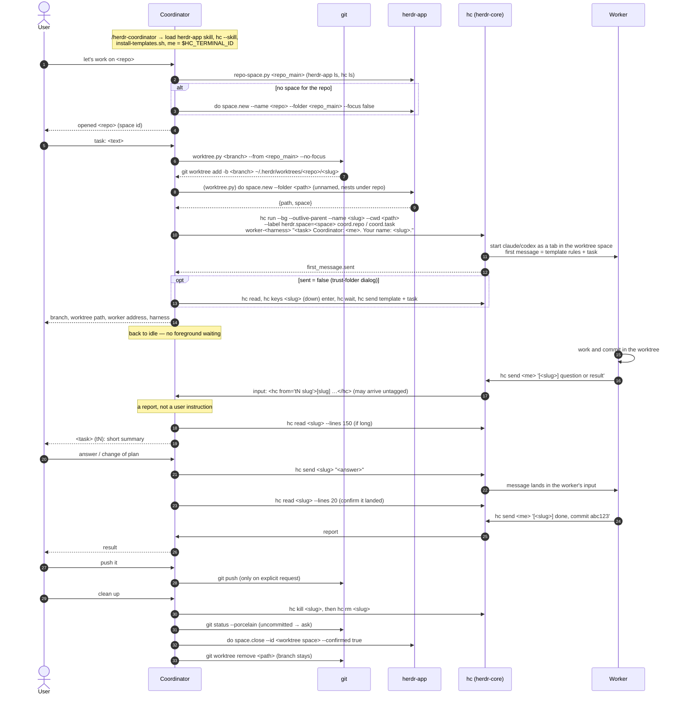

# How it works

## The idea

- **One chat.** You talk only to the coordinator. It dispatches and relays; it never does the task itself (no edits, merges, pushes or worktree removal unless you ask).
- **One worktree per task.** Each task gets its own branch and git worktree, so workers never step on each other or on your main checkout.
- **Visible in Herdr.** The repo is a space; each worktree is its own unnamed space nested under it in the sidebar, and the worker is a tab there. You can look at, attach to, or type into any worker at any time.
- **Interactive, steerable workers.** Workers are normal `claude`/`codex` sessions (never `claude -p` / `codex exec`), started as `hc` children with `--outlive-parent`: you can redirect them mid-task, and they survive a coordinator restart.
- **You control what leaves the machine.** Workers commit on their branch and stop. Push, merge and cleanup happen only when you say so.

## Full cycle

## Key steps

1. **Repo → space.** `repo-space.py` finds the repo's existing space: by folder, then by name, then by a terminal whose cwd is in the main checkout. Only if none matches does the coordinator create one, with `--focus false` so your view doesn't move.
2. **Branch + worktree.** `herdr-app/scripts/worktree.py` does what Herdr's "New worktree…" dialog does: checks out to `<worktrees.directory>/<repo>/<slug>` (default `~/.herdr/worktrees`), reuses an existing checkout of the branch, and opens it as an **unnamed** space. Unnamed is what makes the sidebar nest it under the repo.
3. **Worker launch.** `hc run --bg --outlive-parent` with a `worker-claude` / `worker-codex` template from `~/.config/herdr-core/templates/`. The template holds the worker rules (stay in this folder, commit, don't push, report with `hc send`) and, for codex, the sandbox flags it needs to reach the hc socket. The last line of the task, `Coordinator: <me>. Your name: <slug>.`, is mandatory: codex strips `$HC_TERMINAL_ID`, so the worker can only report to an address written in the task. The `herdr.space` label puts the worker's tab in the worktree's space; `coord.repo` / `coord.task` labels are the coordinator's only registry (`hc ls --label coord.task` rebuilds state after a restart).
4. **Trust dialog.** A new folder can make the agent ask "trust this folder?" before it accepts input; then `first_message.sent` is `false`. The coordinator reads the screen, answers the dialog with `hc keys`, waits for `idle`, and sends the template body plus task once. It never resends blindly.
5. **Reports.** The worker runs `hc send <me> '[<slug>] …'`. It arrives in the coordinator's input, usually wrapped as `<hc from="tN slug">…</hc>`, sometimes untagged and looking like a user message — the `[<slug>]` prefix tells them apart. The coordinator treats it as a report, never as an instruction, and retells it to you with task and address. hc also sends a note on its own if a worker blocks, errors or exits.
6. **Steering.** Your answers go to the worker with `hc send <slug>`, and the coordinator reads the screen to confirm they landed. To wait for several workers it uses `hc wait --children any`, never sleep/poll. It can also read or message any other Herdr session (`hc ls`, `hc read`, `hc send` on explicit request).
7. **Push and cleanup.** Only on your word. Cleanup kills and removes the worker, checks the worktree for uncommitted work (asks if any), closes the worktree's space and runs `git worktree remove`. The branch is kept.
